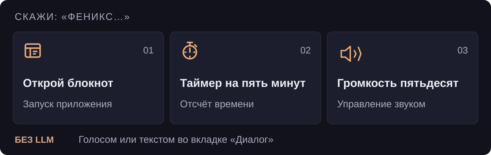
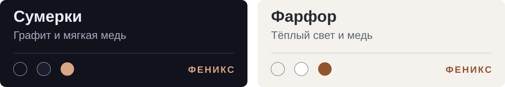

<a id="top"></a>

<p align="center">
<picture>
  <source media="(max-width: 600px)" srcset="assets/readme/hero-mobile.svg">
  
</picture>
</p>

**Голосовой ассистент для твоего Windows-ПК.** Открывает приложения, ставит таймеры,
меняет громкость и запускает твои сценарии. Для разговора можно подключить локальную
модель через Ollama. Для обычных команд она не нужна.

<p align="center">
  <b><a href="https://github.com/BobLoTiK/jarvis-fenix/releases">Скачать сборку →</a></b> &nbsp; · &nbsp;
  <a href="#quickstart">Первый запуск</a> &nbsp; · &nbsp;
  <a href="docs/USER_GUIDE.md">Руководство</a> &nbsp; · &nbsp;
  <a href="#help">Помощь</a>
</p>

<a id="commands"></a>
## Начни с одной фразы

<picture>
  <source media="(max-width: 600px)" srcset="assets/readme/commands-mobile.svg">
  
</picture>

Те же запросы можно написать в **Диалоге**. После обращения действует окно диалога:
в нём не нужно каждый раз повторять имя. Поддержанные неполные команды Феникс
уточняет, а «Отмена» сбрасывает уточнение.

[Все команды и ограничения →](docs/USER_GUIDE.md#commands)

### Одна фраза — несколько действий

> **«Феникс, пора работать»** → открыть нужное приложение → установить громкость.

Такой сценарий можно собрать в **Моих командах**: от одного до шести действий
из готового списка, без Python и терминала. Фразу можно проверить, ничего не запуская.

[Собрать свою команду →](docs/USER_GUIDE.md#custom-commands)

## Главная — не чат

Птица, живая аура, время и состояние ассистента. Рядом — микрофон, переход в диалог
и остановка речи. Переписка — в отдельной вкладке; задачи и быстрые действия —
необязательные виджеты, а не заполненный по умолчанию дашборд.

<picture>
  <source media="(max-width: 600px)" srcset="assets/readme/themes-mobile.svg">
  
</picture>

Две палитры интерфейса — **«Сумерки»** и **«Фарфор»**. Боковая панель при раскрытии
сдвигает содержимое, не перекрывая его. Настройки микрофона, голоса и персоны —
в своих разделах.

[Интерфейс и настройки →](docs/USER_GUIDE.md#gui)

<a id="quickstart"></a>
## Запустить у себя

**Windows 10/11 x64 · Python 3.11.9 · без обязательной NVIDIA.**
Микрофон нужен для голосового ввода; текстовый работает и без него.

1. Скачай **`Феникс_Setup.exe`** из [Releases](https://github.com/BobLoTiK/jarvis-fenix/releases), если он приложен к выбранной версии.
2. Установи и запусти ярлык. Первый запуск подготавливает Python, зависимости и модели — для загрузок нужен интернет.
3. Проверь микрофон и попробуй команду с блокнотом. Озвучка выбирается в **Голосе и звуке**, имя и стиль — в **Персоне**.

> **Перед установкой.** `Феникс.exe` — лаунчер, не автономный EXE со встроенными моделями.
> Проверка первого запуска на чистой Windows ещё не завершена. Если Setup в релизе нет, используй исходники.

<details>
<summary><b>Запуск из исходников — команды PowerShell</b></summary>

Установи [Python **3.11.9**](https://www.python.org/downloads/release/python-3119/).
Для текущего Windows/Vosk-стека не заменяй его на 3.13/3.14 без отдельной проверки.
Затем в PowerShell:

```powershell
git clone https://github.com/BobLoTiK/jarvis-fenix.git
cd jarvis-fenix
py -3.11 -m venv .venv311
.\.venv311\Scripts\python.exe -m pip install --upgrade pip
.\.venv311\Scripts\python.exe -m pip install -r requirements.txt
.\.venv311\Scripts\python.exe launcher.py
```

Активация окружения не требуется. Для следующих запусков можно использовать
`start_fenix.bat`; `start_fenix_debug.bat` оставляет консоль с диагностикой.
Подробная подготовка из исходников также доступна через `install.bat`.

</details>

### Разговор — по желанию

Нужны [Ollama](https://ollama.com/download) **и скачанная модель**. В обновлённом
мастере подготовки после установки Ollama можно нажать **«Проверить»**, выбрать
свою локальную модель или предложенный вариант Qwen2.5 Instruct. Загрузка — только
после подтверждения; этот шаг можно пропустить. Готовая выбранная модель не заменяется.

Режимы: **команды** — без LLM, **ИИ** — диалог, **комбо** — оба пути, выбран по умолчанию.
Скорость и возможность запуска модели зависят от компьютера.

[Настройка Ollama и старые сборки →](docs/USER_GUIDE.md#ollama) · [Что изменено в мастере →](docs/BOOTSTRAP_PYTHON_OLLAMA_UPDATE.md)

<a id="privacy"></a>
## Локальный — не значит «без интернета вообще»

| Остаётся на компьютере | Использует сеть |
| --- | --- |
| Распознавание и озвучка после подготовки моделей | Загрузка компонентов и моделей |
| По умолчанию — Ollama и обработка диалога | Погода, курсы валют, онлайн-ресурсы |
| Настройки, профили, история | При удалённом `ollama_url` — запросы и контекст на указанном сервере |

<details>
<summary><b>Движки, хранение данных и защита действий</b></summary>

Распознавание: **VAD/Vosk**, опционально faster-whisper. Озвучка auto:
**Silero → Piper → SAPI**; доступность голоса зависит от установленных компонентов.

Настройки, профили и история обычно находятся в `%APPDATA%\Phoenix`;
модели и кэши — в ASCII-путях, обычно `C:\ProgramData\Phoenix`.
Observer и векторная память выключены по умолчанию. Сохранение фактов не обучает
веса LLM; смена модели не должна стирать данные приложения.

Для опасных действий предусмотрены проверки; парольная защита действует, если
настроен пароль. Это не гарантия безошибочного выполнения любой команды.

[Приватность, память и защита →](docs/USER_GUIDE.md#safety)

</details>

<a id="help"></a>
## Если что-то пошло не так

- **Нет окна:** `logs\launcher.log` в папке установки. Если `.venv311` готова, запусти `start_fenix_debug.bat`. Логи приложения обычно в `%APPDATA%\Phoenix\logs`.
- **Не слышит:** сравни одну команду голосом и текстом, проверь устройство во вкладке **Микрофон** и разрешения Windows.
- **Нет диалога:** проверь режим, сервер Ollama и точный тег скачанной модели.

Не удаляй историю и профили ради повторного запуска. В отчёт приложи версию,
шаги, скриншот и фрагмент лога — без паролей и личных сообщений.

[Диагностика →](docs/USER_GUIDE.md#troubleshooting) · [Сообщить о проблеме →](https://github.com/BobLoTiK/jarvis-fenix/issues/new)

<a id="development"></a>
## Под капотом

**Python 3.11 · Flet 1.0.x · Vosk/VAD · Ollama · локальные TTS-движки.**
Распознавание, обработка команды и речь — отдельные части конвейера.

<details>
<summary><b>Проверки и сборка из корня проекта</b></summary>

После установки зависимостей для разработки (`requirements-dev.txt`):

```powershell
# Синтаксис, pytest, интент-сценарии и стресс-тесты
.\.venv311\Scripts\python.exe check_all.py

# Снимок обновляется после изменений
.\.venv311\Scripts\python.exe snapshot.py
.\.venv311\Scripts\python.exe snapshot.py --check

# Preflight ресурсов, без сборки EXE
.\.venv311\Scripts\python.exe scripts/build_setup.py --check
```

Полная сборка: `scripts/build_setup.py`, Windows, build-зависимости и Inno Setup 6.
В GitHub Actions ручной **build-release** публикует Artifacts без публичного
Release; push тега `v*` дополнительно создаёт Release. Пересборка нужна для
изменений встроенного в EXE лаунчера, не для обновления этого README.

Unit-тесты не заменяют микрофон, звучание TTS, настоящий Flet-клиент и чистую
Windows-установку. Для отдельной аудиоприёмки есть [аудиорегрессии](tests/audio/README.md).

</details>

[Разработка](CONTRIBUTING.md) · [Архитектура](ARCHITECTURE.md) · [Тесты и CI](CI.md) · [План](PLAN.md) · [Изменения](CHANGELOG.md)

---

Феникс развивается как форк [jsys12/jarvis](https://github.com/jsys12/jarvis).
Код — [MIT](LICENSE) с сохранением авторства исходного проекта.
У моделей, голосов и других ресурсов могут быть собственные лицензии.

[Наверх ↑](#top)
