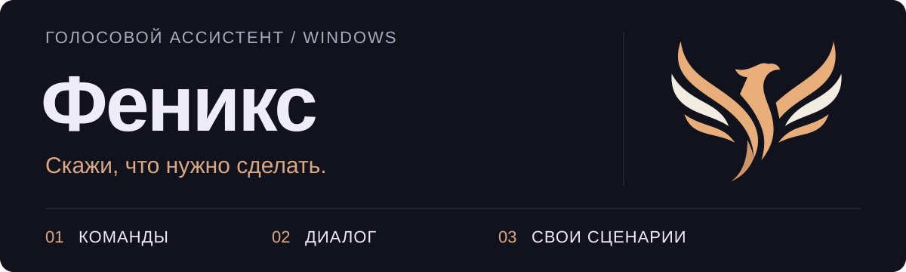

<a id="top"></a>

<p align="center">
  <picture>
    <source media="(max-width: 600px)" srcset="assets/readme/hero-mobile.svg">
    
  </picture>
</p>

<p align="center">
  <a href="https://github.com/BobLoTiK/jarvis-fenix/actions/workflows/test.yml"></a>
  <a href="https://github.com/BobLoTiK/jarvis-fenix/releases"></a>
  <a href="https://www.python.org/downloads/release/python-3119/"></a>
  <a href="LICENSE"></a>
</p>

<p align="center">
  <b>Управляй компьютером. Разговаривай. Настраивай под себя.</b><br>
  Русскоязычный голосовой ассистент с локальным распознаванием речи,<br>
  несколькими голосами и необязательной LLM через Ollama.
</p>

<p align="center">
  <a href="#quickstart">Установить</a> ·
  <a href="#commands">Попробовать команды</a> ·
  <a href="docs/USER_GUIDE.md">Руководство</a> ·
  <a href="#help">Решить проблему</a> ·
  <a href="PLAN.md">План развития</a>
</p>

---

## Не только поговорить

| Возможность | Что это даёт |
|:--|:--|
| **Управление Windows** | Приложения, сайты, окна, громкость, медиа, таймеры и напоминания. |
| **Живой диалог** | Локальная модель через Ollama, стиль общения, персона и история разговора. |
| **Голос на выбор** | Silero, Piper, WinRT или SAPI; перебивание речи и необязательные звуковые реакции. |
| **Уточнения вместо догадок** | Недостающие параметры поддержанных команд можно досказать; сомнительное распознавание вызывает просьбу повторить. |
| **Русский язык** | Числа словами в командах, подготовка числительных и контекстных римских цифр для озвучки. |
| **Настройка под себя** | Профили, паки и свои команды; окно Flet с чатом, настройками микрофона, аудио и персоны. |

**Быстрые команды не требуют Ollama.** Для разговоров можно подключить локальную модель.
Погода, курсы валют и первичная загрузка моделей используют сеть — подробнее [о приватности](#privacy).

<a id="quickstart"></a>
## Быстрый старт

**Нужно:** Windows 10/11 x64, Python **3.11** и микрофон для голосового управления.
Проверенная рабочая версия Python — **3.11.9**. Для Windows-аудиостека не выбирай
3.13/3.14 без отдельной проверки совместимости. NVIDIA GPU не обязателен;
скорость Whisper и LLM зависит от оборудования и выбранных моделей.

### Из исходников · PowerShell / терминал VS Code

```powershell
git clone https://github.com/BobLoTiK/jarvis-fenix.git
cd jarvis-fenix
py -3.11 -m venv .venv311
.\.venv311\Scripts\python.exe -m pip install --upgrade pip
.\.venv311\Scripts\python.exe -m pip install -r requirements.txt
.\.venv311\Scripts\python.exe -m jarvis
```

Активировать окружение необязательно: команды используют его Python напрямую.
В VS Code выбери `.venv311\Scripts\python.exe` через **Python: Select Interpreter**.
Вместо ручной установки зависимостей в корне проекта можно запустить `install.bat`.

<details>
<summary><b>Хочу через установщик</b></summary>

Открой [Releases](https://github.com/BobLoTiK/jarvis-fenix/releases) и выбери
`Феникс_Setup.exe`, если установщик опубликован в нужном релизе.
Если готового файла нет, используй запуск из исходников выше.

`Феникс.exe` — лёгкий лаунчер, **не автономное приложение со встроенным Python**.
Первый запуск подготавливает окружение и модели; для этого нужен интернет.
Подробности — [установка и первый запуск](docs/USER_GUIDE.md#install).

</details>

### После запуска

1. Открой вкладку **Микрофон**, выбери устройство и нажми **«Проверить (3 сек)»**.
2. Скажи **«Феникс, открой блокнот»**. Для диагностики ту же команду можно ввести в чат.
3. На **Главной** выбери голос, в **Настройках** — TTS-движок. В **Персоне** — имя и стиль общения.
4. Для разговоров установи [Ollama](https://ollama.com/download), затем загрузи модель:

```powershell
ollama pull qwen2.5:7b-instruct
```

В настройках Феникса укажи установленный тег модели и адрес `http://127.0.0.1:11434`.
Можно выбрать другую доступную локальную модель; меньший размер не гарантирует
такого же качества команд и диалога. [Настройка Ollama →](docs/USER_GUIDE.md#ollama)

<a id="commands"></a>
## Скажи — и попробуй

| Хочется | Пример фразы |
|:--|:--|
| Открыть приложение | «Феникс, открой блокнот» |
| Сделать потише | «Громкость пятьдесят» |
| Узнать время | «Который час?» |
| Не забыть про чай | «Напомни выпить чай через пять минут» |
| Прочитать активное окно | «Прочитай окно» |
| Сменить стиль | «Говори на ты» |
| Поболтать с моделью | «Расскажи что-нибудь» |
| Разобраться с ошибкой | «Что ты слышал?» / «Почему не понял?» |

После обращения или во время окна диалога короткий ответ можно произнести без
повторного «Феникс». Поддержка окон зависит от UI Automation конкретного приложения.

**Не обязательно говорить всё одной фразой:**

```text
Ты       Открой.
Феникс   Какое приложение открыть?
Ты       Блокнот.
```

```text
Ты       Поставь таймер на десять.
Феникс   В каких единицах?
Ты       Минут.
```

«Отмена» сбрасывает незавершённое уточнение. Поправки работают **до исполнения**;
изменять уже созданный таймер таким ответом пока нельзя.
[Больше команд и ограничения →](docs/USER_GUIDE.md#commands)

### Три режима — без лишней магии

| Режим | Для чего |
|:--|:--|
| **Команды** · `commands` | Поддержанные быстрые действия без LLM. |
| **ИИ** · `llm` | Разговор с выбранной моделью. |
| **Комбо** · `combo` | Быстрые команды и LLM в одном режиме; выбран по умолчанию. |

Переключай в GUI или голосом: «режим команд», «режим ии», «режим комбо».

<a id="privacy"></a>
## Локальный — с понятными границами

- **Речь обрабатывается локально** после установки нужных моделей и зависимостей.
  Текущий стек: VAD → Vosk → необязательный Whisper → проверка уверенности.
- **Ollama по умолчанию на этом компьютере.** Если изменить `ollama_url` на удалённый
  сервер, контекст разговора будет обрабатываться там.
- **Observer и векторная память выключены по умолчанию.** Включаются отдельно
  в настройках приватности. Факты подбираются по текущему запросу, а не добавляются
  целым профилем в каждый ответ.
- **Данные и логи остаются на диске.** Обычно настройки и профили находятся
  в `%APPDATA%\Phoenix`, модели — в `C:\ProgramData\Phoenix`.
  Не публикуй личные конфиги, историю, пароли и записи голоса.
- **Память — не обучение весов.** Смена LLM не удаляет данные приложения,
  но сохранённый факт не дообучает саму модель.

Погода и валюты обращаются к внешним сервисам. Подтверждения, пароль на опасные
действия и проверки распознавания снижают риск, но не делают автоматизацию безошибочной.
[Память, безопасность и хранение →](docs/USER_GUIDE.md#memory)

<a id="help"></a>
## Если что-то не так

<details>
<summary><b>Не слышит или неправильно распознаёт</b></summary>

Проверь устройство во вкладке **Микрофон** и доступ к микрофону в настройках
приватности Windows. Сначала сравни команду голосом и через чат:
это помогает отделить ошибку распознавания от обработки команды.
«Что ты слышал?» и «Почему не понял?» помогают с диагностикой.
Тест уровня — не измерение точности распознавания.

</details>

<details>
<summary><b>Не запускается / ошибка DLL / не загружается модель</b></summary>

Запусти из терминала командой `.\.venv311\Scripts\python.exe -m jarvis`,
чтобы увидеть ошибку. Проверь Python 3.11, [VC++ Redistributable x64](https://aka.ms/vs/17/release/vc_redist.x64.exe)
и доступ к загрузке моделей. Для Vosk нужен ASCII-путь: не переноси модель
в папку с кириллицей. Не удаляй пользовательские данные ради переустановки.
[Разбор типичных проблем и логи →](docs/USER_GUIDE.md#troubleshooting)

</details>

<details>
<summary><b>Команды работают, а разговора нет</b></summary>

Проверь `ollama list`, адрес сервера, точный тег установленной модели и режим
**ИИ** или **Комбо**. Загрузка модели в Ollama и установка Феникса — разные шаги.
[Настройка и проверка модели →](docs/USER_GUIDE.md#ollama)

</details>

<a id="development"></a>
## Разработка и проверки

Все команды ниже — из корня проекта, после установки зависимостей.

```powershell
# Синтаксис, pytest, интенты и стресс-сценарии
.\.venv311\Scripts\python.exe check_all.py

# После изменений — обновить снимок и проверить его
.\.venv311\Scripts\python.exe snapshot.py
.\.venv311\Scripts\python.exe snapshot.py --check
```

**Аудиорегрессия без повторения фраз вручную:**

```powershell
.\.venv311\Scripts\python.exe scripts/audio_regression.py prepare
.\.venv311\Scripts\python.exe scripts/audio_regression.py run
```

Нужны Windows, установленные локальные модели и системный голос для `prepare`.
Проверяется ограниченный контур распознавания и команд, без реального запуска
приложений; это **не** проверка живого микрофона, GUI или звучания TTS.
[Сценарии, статусы PASS / FAIL / BLOCKED →](tests/audio/README.md)

Локальную проверку подготовленного snapshot перед коммитом можно включить через
`scripts/install_git_hooks.py`. Она проверяет Git index, не делает `git add`,
коммит или push за тебя. [Разработка →](CONTRIBUTING.md) · [CI →](CI.md)

## Найти нужное

| Документ | Когда открыть |
|:--|:--|
| [Руководство пользователя](docs/USER_GUIDE.md) | Голоса, микрофон, команды, профили, память, свои сценарии и сборка. |
| [План развития](PLAN.md) | Очередь работ и критерии готовности. |
| [Архитектура](ARCHITECTURE.md) | Модули, связи и поток обработки. |
| [Источник правды о проекте](PROJECT.md) | Контракты, ограничения и правила изменений. |
| [Тестирование](tests/README.md) | Что проверяется автоматически и что требует Windows. |
| [Аудиотесты](tests/audio/README.md) | Как автоматизировать голосовые регрессии. |
| [Участие в разработке](CONTRIBUTING.md) | Как вносить изменения. |
| [История изменений](CHANGELOG.md) | Что и когда менялось. |

**Сейчас в фокусе — сам Феникс:** удобство и функциональность GUI, затем внешний вид,
качество контекста, скорость и стабильность. Vosk остаётся частью проекта.
Облако и внешние интеграции отложены; актуальная очередь — в [PLAN.md](PLAN.md).

---

**MIT · Сделано на основе [jsys12/jarvis](https://github.com/jsys12/jarvis).**
Авторство оригинального кода и условия использования сохранены в [LICENSE](LICENSE).

[Вернуться наверх ↑](#top)
