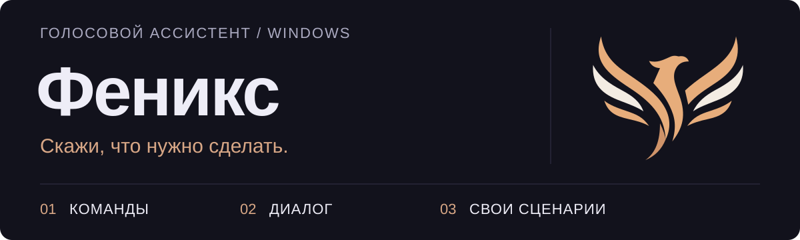
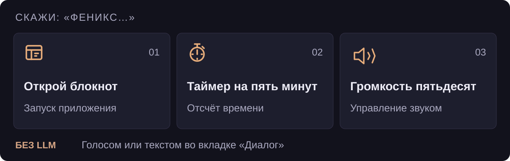
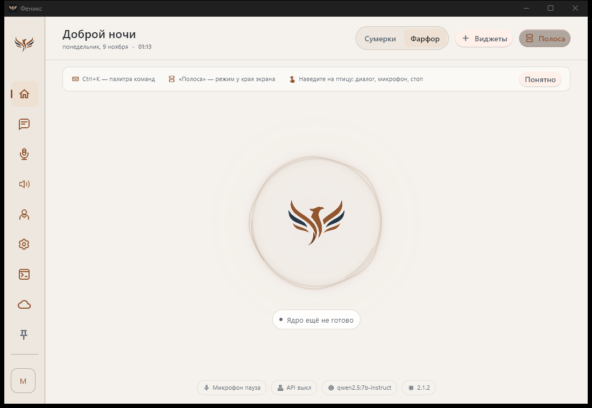
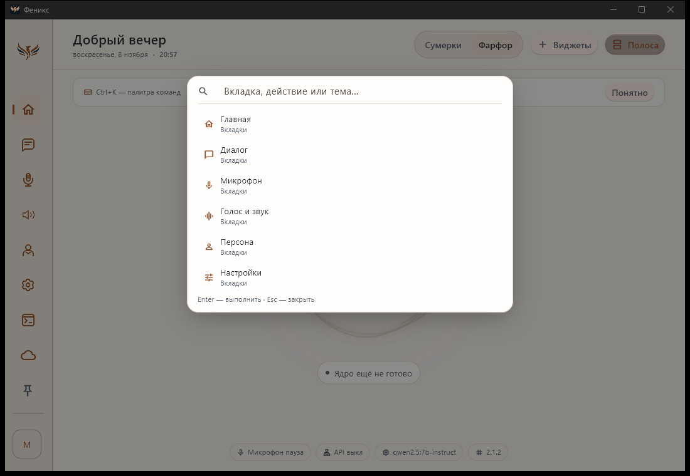
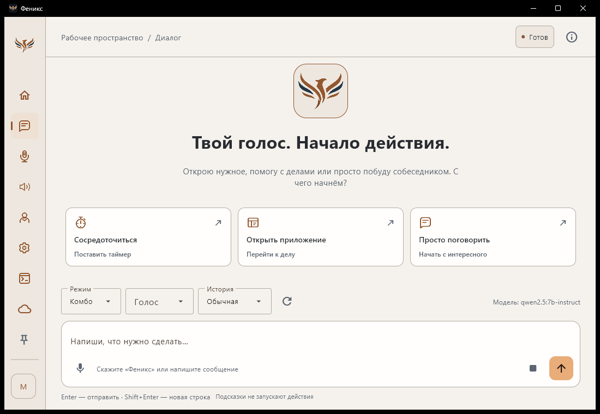
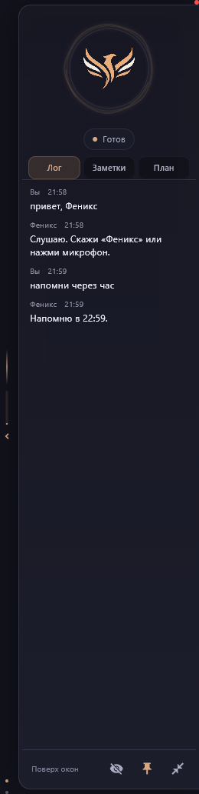
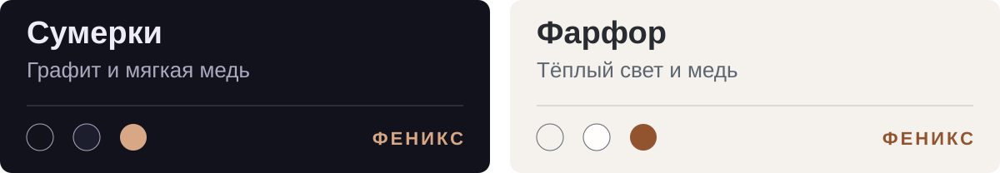
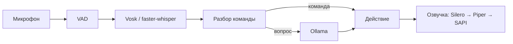

<a id="top"></a>

<p align="center">
<picture>
  <source media="(max-width: 600px)" srcset="assets/readme/hero-mobile.svg">
  
</picture>
</p>

<p align="center">
  <a href="https://github.com/BobLoTiK/jarvis-fenix/releases"></a>
  <a href="https://github.com/BobLoTiK/jarvis-fenix/actions/workflows/test.yml"></a>
  
  
  
</p>

**Феникс** — голосовой ассистент для твоего Windows-ПК: открывает приложения, ставит
таймеры, меняет громкость, запускает твои сценарии и, если подключить Ollama,
просто разговаривает. Обычные команды работают **без модели и без интернета**.

Он живёт в одном окне: птица с живой аурой на **Главной**, переписка в **Диалоге**,
а полоса у края экрана держит ассистента под рукой, когда окно свёрнуто.

<p align="center">
  <b><a href="https://github.com/BobLoTiK/jarvis-fenix/releases">Скачать сборку</a></b> &nbsp;·&nbsp;
  <a href="#quickstart">60 секунд до первой команды</a> &nbsp;·&nbsp;
  <a href="#features">Что умеет</a> &nbsp;·&nbsp;
  <a href="#hotkeys">Горячие клавиши</a> &nbsp;·&nbsp;
  <a href="#docs">Документация</a>
</p>

## Содержание

- [60 секунд до первой команды](#quickstart)
- [Что умеет](#features)
- [Скриншоты](#screens)
- [Одна фраза — несколько действий](#scenarios)
- [Горячие клавиши](#hotkeys)
- [Главная, полоса, пипетка](#shell)
- [Режимы: команды / ИИ / комбо](#modes)
- [Под капотом](#development)
- [Приватность](#privacy)
- [Документация](#docs)
- [Если что-то пошло не так](#help)

<a id="quickstart"></a>
## 60 секунд до первой команды

**Windows 10/11 x64 · Python 3.11.9 · без обязательной NVIDIA.**
Микрофон нужен для голоса; текстом можно пользоваться и без него.

1. **Скачай установщик** из [Releases](https://github.com/BobLoTiK/jarvis-fenix/releases):
   - `Feniks_Fast_Setup_2.2.0.exe` — **~310 МБ**, автономно: свой Python и библиотеки внутри;
   - `Feniks_Setup_2.2.0.exe` — **~15 МБ**, лёгкий: зависимости ставятся при первом запуске.
2. **Установи и запусти ярлык.** Автономному интернет для зависимостей не нужен,
   лёгкому — нужен. Модель распознавания речи Vosk скачивается отдельно.
3. **Нажми <kbd>Ctrl</kbd> + <kbd>K</kbd>** — откроется палитра команд. Набери
   «микрофон» или выбери вкладку. Либо просто скажи: **«Феникс, открой блокнот»**.

Чек-лист первого запуска:

- [ ] Микрофон выбран во вкладке **Микрофон**, Windows не блокирует доступ
- [ ] Команда «Феникс, открой блокнот» сработала голосом или текстом
- [ ] Озвучка выбрана в **Голосе и звуке** (Silero → Piper → SAPI)
- [ ] Имя и стиль — в **Персоне**
- [ ] Для разговора — Ollama и скачанная модель (шаг можно пропустить)

> **Перед установкой.** `Феникс.exe` — лаунчер, а не автономный EXE с моделями;
> автономная поставка — это `Feniks_Fast_Setup_2.2.0.exe`. Файлы не подписаны,
> SmartScreen предупредит. Приёмка на чистой Windows ещё не завершена.

<details>
<summary><b>Запуск из исходников — команды PowerShell</b></summary>

Установи [Python **3.11.9**](https://www.python.org/downloads/release/python-3119/).
Для текущего Windows/Vosk-стека не заменяй его на 3.13/3.14 без отдельной проверки.

```powershell
git clone https://github.com/BobLoTiK/jarvis-fenix.git
cd jarvis-fenix
py -3.11 -m venv .venv311
.\.venv311\Scripts\python.exe -m pip install --upgrade pip
.\.venv311\Scripts\python.exe -m pip install -r requirements.txt
.\.venv311\Scripts\python.exe launcher.py
```

Активация окружения не нужна. Дальше удобно `start_fenix.bat`,
`start_fenix_debug.bat` оставляет консоль с диагностикой, `install.bat` — полная подготовка.

</details>

<a id="features"></a>
## Что умеет

| Уметь | Как попробовать |
| --- | --- |
| Открывать приложения и сайты | «Феникс, открой блокнот», «Феникс, открой youtube» |
| Таймеры, будильники, напоминания | «Феникс, таймер на пять минут», «напомни через час» |
| Громкость, воспроизведение, окна | «Феникс, громкость пятьдесят», «сверни окно» |
| Погода, курсы, поиск | спроси голосом или текстом в **Диалоге** |
| Свои сценарии из 1–6 действий | вкладка **Мои команды**, без Python |
| Разговор с локальной моделью | режим **ИИ** через [Ollama](https://ollama.com/download) |
| Полоса у края экрана | кнопка **«Полоса»** на Главной или <kbd>Ctrl</kbd>+<kbd>K</kbd> → «Полоса» |
| Свернуть всё в пилюлю 136×56 | <kbd>Ctrl</kbd>+<kbd>Shift</kbd>+<kbd>P</kbd> или палитра → «Пипетка» |

<p align="center">
<picture>
  <source media="(max-width: 600px)" srcset="assets/readme/commands-mobile.svg">
  
</picture>
</p>

После обращения действует окно диалога: имя не нужно повторять каждый раз.
Неполные команды Феникс уточняет, «Отмена» сбрасывает уточнение.

[Все команды и ограничения →](docs/USER_GUIDE.md#commands)

<a id="screens"></a>
## Скриншоты

Реальные окна текущей сборки, тема **«Фарфор»** (светлая). Состояние в статус-баре
показано честно: без запущенной модели ядро так и пишет — «ещё не готово».

<p align="center">
  
  <br><sub><b>Главная</b> — приветствие по времени, подсказки первого запуска, статус-бар с микрофоном, API, моделью и версией.</sub>
</p>

<p align="center">
  
  <br><sub><b>Палитра команд</b> — <kbd>Ctrl</kbd>+<kbd>K</kbd>: одна строка поиска по вкладкам, действиям и темам.</sub>
</p>

<details>
<summary><b>Ещё два экрана: диалог и полоса у края</b></summary>

<p align="center">
  
  <br><sub><b>Диалог</b> — пока переписки нет, предлагает три сценария быстрого старта.</sub>
</p>

<p align="center">
  
  <br><sub><b>Полоса</b> — режим у края экрана: свечение, состояние, панели Лог/Заметки/План.</sub>
</p>

</details>

<a id="scenarios"></a>
## Одна фраза — несколько действий

> **«Феникс, пора работать»** → открыть нужное приложение → установить громкость.

Сценарий собирается в **Моих командах**: от одного до шести действий из готового
списка, без Python и терминала. Фразу можно проверить, ничего не запуская.

[Собрать свою команду →](docs/USER_GUIDE.md#custom-commands)

<a id="hotkeys"></a>
## Горячие клавиши

| Клавиши | Что делает |
| --- | --- |
| <kbd>Ctrl</kbd>+<kbd>K</kbd> | палитра команд: вкладки, действия, темы |
| <kbd>Ctrl</kbd>+<kbd>Shift</kbd>+<kbd>F</kbd> | фокус-режим: остаются птица и состояние |
| <kbd>Ctrl</kbd>+<kbd>Shift</kbd>+<kbd>P</kbd> | пипетка 136×56 у правого нижнего угла |
| <kbd>Esc</kbd> | закрыть палитру, выйти из фокуса или пипетки |
| <kbd>Enter</kbd> / <kbd>Shift</kbd>+<kbd>Enter</kbd> | отправить сообщение / новая строка |

Фокус-режим подсказывает выход тостом «Esc — вернуть всё». Вернуть подсказки первого
запуска можно командой палитры **«Показать подсказки на Главной»** или свитчем в
**Настройках → Внешний вид**.

<a id="shell"></a>
## Главная, полоса, пипетка

Три формы одного ассистента — по тому, насколько он нужен под рукой:

1. **Главная.** Птица с живой аурой, время, состояние и три быстрых действия.
   Переписка живёт в отдельной вкладке; виджеты — необязательные, а не дашборд по умолчанию.
2. **Полоса.** Узкая колонка у правого края: уровень микрофона, бейдж непрочитанного,
   точки панелей и режим «не прятать», если нужно, чтобы полоса не уезжала.
3. **Пипетка.** Окно сжимается в пилюлю 136×56 с птицей и точкой состояния; клик
   возвращает прежний размер и место.

Две палитры: **«Сумерки»** (графит и медь) и **«Фарфор»** (тёплый свет и медь).

<p align="center">
<picture>
  <source media="(max-width: 600px)" srcset="assets/readme/themes-mobile.svg">
  
</picture>
</p>

[Интерфейс и настройки →](docs/USER_GUIDE.md#gui)

<a id="modes"></a>
## Режимы: команды / ИИ / комбо

- **Команды** — без LLM: быстро, предсказуемо, работает офлайн.
- **ИИ** — диалог через локальную Ollama: свободные вопросы и болтовня.
- **Комбо** — выбран по умолчанию: сначала пробуем команду, потом модель.

Нужны [Ollama](https://ollama.com/download) и скачанная модель. В мастере подготовки
есть кнопка **«Проверить»**, выбор своей модели или Qwen2.5 Instruct; загрузка — только
после подтверждения. Готовая выбранная модель не заменяется.

[Настройка Ollama →](docs/USER_GUIDE.md#ollama)

<a id="development"></a>
## Под капотом

**Python 3.11 · Flet 1.0.x · Vosk/VAD · Ollama · локальные TTS.**



<details>
<summary><b>Проверки и сборка из корня проекта</b></summary>

После `requirements-dev.txt`:

```powershell
# Синтаксис, pytest, интент-сценарии и стресс-тесты
.\.venv311\Scripts\python.exe check_all.py

# Снимок проекта
.\.venv311\Scripts\python.exe snapshot.py
.\.venv311\Scripts\python.exe snapshot.py --check

# Preflight ресурсов без сборки EXE
.\.venv311\Scripts\python.exe scripts/build_setup.py --check
```

Полная сборка — `scripts/build_setup.py` (Windows, Inno Setup 6). В GitHub Actions
ручной **build-release** публикует Artifacts без публичного Release; push тега `v*`
дополнительно создаёт Release. Unit-тесты не заменяют микрофон, звучание TTS,
Flet-клиент и установку на чистую Windows; для отдельной аудиоприёмки есть
[аудиорегрессии](tests/audio/README.md).

</details>

[Разработка](CONTRIBUTING.md) · [Архитектура](ARCHITECTURE.md) · [Тесты и CI](CI.md) · [План](PLAN.md) · [Изменения](CHANGELOG.md)

<a id="privacy"></a>
## Локальный — не значит «без интернета вообще»

| Остаётся на компьютере | Использует сеть |
| --- | --- |
| Распознавание и озвучка после подготовки моделей | Загрузка компонентов и моделей |
| По умолчанию — Ollama и обработка диалога | Погода, курсы валют, онлайн-ресурсы |
| Настройки, профили, история | При удалённом `ollama_url` — запросы и контекст на указанном сервере |

<details>
<summary><b>Движки, хранение данных и защита действий</b></summary>

Распознавание: **VAD/Vosk**, опционально faster-whisper. Озвучка auto:
**Silero → Piper → SAPI**; доступность голоса зависит от установленных компонентов.

Настройки, профили и история обычно лежат в `%APPDATA%\Phoenix`;
модели и кэши — в ASCII-путях, обычно `C:\ProgramData\Phoenix`.
Observer и векторная память выключены по умолчанию. Сохранение фактов не обучает
веса LLM; смена модели не стирает данные приложения.

Для опасных действий есть проверки; парольная защита работает, если задан пароль.
Это не гарантия безошибочного выполнения любой команды.

[Приватность, память и защита →](docs/USER_GUIDE.md#safety)

</details>

<a id="docs"></a>
## Документация

| Документ | О чём |
| --- | --- |
| [Руководство пользователя](docs/USER_GUIDE.md) | установка, команды, интерфейс, голос, настройка, диагностика |
| [Карта документации](docs/README.md) | что где лежит и с чего начать |
| [Тесты и CI](CI.md) | как устроены проверки и что запускается на push |
| [Архитектура](ARCHITECTURE.md) | модули, потоки, контракты подсистем |
| [Участие в разработке](CONTRIBUTING.md) | стиль, тесты, требования к изменениям |
| [План и очередь](PLAN.md) · [Следующие шаги](docs/NEXT_STEPS.md) | куда движется проект |
| [Изменения](CHANGELOG.md) | что менялось и когда |
| [Приёмка](docs/ACCEPTANCE_CHECKLIST.md) | чек-лист проверки сборки |
| [Сборка автономного EXE](docs/FULL_NUITKA_BUILD.md) | длинная сборка Nuitka, требования |

<a id="help"></a>
## Если что-то пошло не так

<details>
<summary><b>Нет окна после запуска</b></summary>

- `logs\launcher.log` в папке установки.
- Если `.venv311` уже готова: `start_fenix_debug.bat` покажет консоль.
- Логи приложения обычно в `%APPDATA%\Phoenix\logs`.
</details>

<details>
<summary><b>Не слышит</b></summary>

Сравни одну команду голосом и текстом. Проверь устройство во вкладке **Микрофон**
и разрешения Windows. Если текст работает, а голос нет — дело в микрофоне или модели Vosk.
</details>

<details>
<summary><b>Нет диалога</b></summary>

Проверь режим (**ИИ** или **Комбо**), что Ollama запущена и что тег модели совпадает
с выбранным. В мастере подготовки есть кнопка **«Проверить»**.
</details>

Не удаляй историю и профили ради повторного запуска. В отчёт приложи версию, шаги,
скриншот и фрагмент лога — **без паролей и личных сообщений**.

[Диагностика →](docs/USER_GUIDE.md#troubleshooting) · [Сообщить о проблеме →](https://github.com/BobLoTiK/jarvis-fenix/issues/new)

---

Феникс развивается как форк [jsys12/jarvis](https://github.com/jsys12/jarvis).
Код — [MIT](LICENSE) с сохранением авторства исходного проекта.
У моделей, голосов и других ресурсов могут быть собственные лицензии.

[Наверх ↑](#top)
